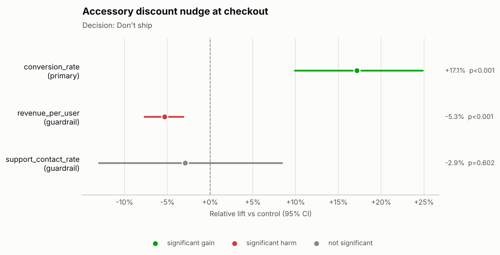
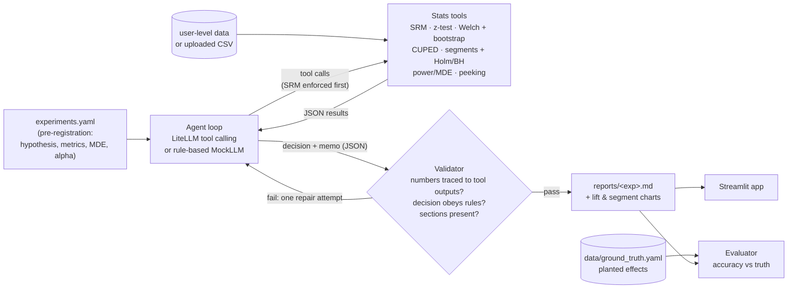

# A/B Test Readout Agent

  
<!-- After pushing, swap in a CI badge: https://github.com/saranyabalantrapu123-cmd/ab-test-agent/actions -->

**An LLM agent that turns raw, user-level A/B test data into a validated ship decision memo in seconds. It runs the checks a senior analyst would run, in the same order every time, and refuses to ship an invalid test.**

## Why this matters

Most product teams read out experiments by hand: someone pulls the data, runs a z-test in a notebook, maybe checks guardrails, and writes a slide. That takes days, it depends on who does it, and the mistakes it lets through are expensive:

- **Shipping a broken test.** A sample-ratio mismatch (SRM) means randomization or logging failed. The "lift" may only reflect which users went missing.
- **Shipping a hidden loss.** A discount lifts conversion but cuts revenue per user.
- **Shipping to everyone when only one segment benefits**, or **killing a good idea** because the test was underpowered and read too early.

This project re-creates, from scratch, an automated testing tool of the kind I built and rolled out org-wide, where it replaced manual test analysis with on-demand runs. The agent gives you:

- **Faster readouts.** A full readout (SRM, effects, guardrails, power, peeking, segments, memo and charts) runs on demand in about a second offline.
- **Consistent statistical rigor.** Every test gets the same checks: SRM first, Holm-corrected segment cuts, CUPED variance reduction and sequential-testing warnings.
- **Fewer wrong ship decisions.** Hard decision rules and a validator block "Ship" when a test has an SRM or a guardrail regression, and they catch numbers the LLM made up.

## Demo


*Add your recording here (`docs/demo.gif`): `make app`, pick an experiment, click **Run analysis**.*

Real outputs from `make demo` (offline mode):

| Guardrail breach: conversion up, revenue per user down | Effect concentrated on app users only |
|---|---|
|  |  |

Sample memo: [`reports/exp_discount_nudge.md`](reports/exp_discount_nudge.md). All six memos are in [`reports/`](reports/).

## Architecture



## Quickstart

Offline demo (no API key, no network; outputs are rule-based):

```bash
make setup      # pip install -r requirements.txt
make demo       # generates data, analyses all 6 experiments, writes reports/
make app        # Streamlit UI at http://localhost:8501
```

With a real model:

```bash
cp .env.example .env          # set ANTHROPIC_API_KEY (or LLM_MODEL=openai/... + OPENAI_API_KEY)
export $(grep -v '^#' .env | xargs)
make demo && make eval        # token usage and estimated cost are printed per run
```

Other targets: `make data`, `make test`, `make eval`. Docker: `docker build -t ab-test-agent . && docker run -p 8501:8501 -e ANTHROPIC_API_KEY ab-test-agent`.

## How it works

**Agent tools** (`abagent/tools.py`), each a thin wrapper around a pure function in `abagent/stats.py` that returns structured JSON:

| Tool | What it does |
|---|---|
| `get_experiment_metadata` | Pre-registered hypothesis, primary and guardrail metrics, MDE, alpha, planned duration |
| `check_srm` | Chi-square sample-ratio-mismatch test (p < 0.001 flags the test as invalid) |
| `estimate_effect` | Proportions: pooled two-proportion z-test, Wald CI and a delta-method CI on relative lift. Means: Welch t-test and bootstrap CI on relative lift, with optional **CUPED** |
| `segment_breakdown` | Per-segment effects with **Holm** (FWER) or **Benjamini-Hochberg** (FDR) correction, plus Cochran's Q heterogeneity test |
| `power_analysis` | Required users per arm (Cohen's h / d), achieved power, current detectable lift, extra days needed |
| `check_duration` | Peeking check: days vs plan, weekly cycles, information fraction, O'Brien-Fleming sequential alpha |

**Agent loop** (`abagent/agent.py`). The model states a plan, then calls tools. The harness **enforces SRM first**: any other statistical tool called before `check_srm` gets an error back. The model finishes with `{decision, scope, memo_markdown}`, where the decision is one of **Ship / Don't ship / Investigate / Inconclusive-extend**.

**Guardrails** (`abagent/validator.py`, `abagent/decision.py`):
- **Hallucination check:** every number in the memo must match a tool output, allowing for rounding and for fractions shown as percentages. Dates are checked the same way.
- **Consistency rules:** never Ship with an SRM, never Ship with a significant guardrail regression, and only Ship on a significant primary-metric win.
- **Structure:** the memo must have the Decision, Key numbers, Guardrails, Segment insights, Risks and Next steps sections.
- A real model that fails validation gets **one repair attempt** with the validator's feedback. If it still fails, the memo is marked failed. It is not silently replaced.

**Offline MockLLM.** A deterministic planner calls metadata, SRM, effects, guardrails (with CUPED), power, duration and segments. It applies the same playbook the real model is given and fills in a memo template. It runs through the same agent loop and the same validator.

## Evaluation

The data is **generated with known, planted effects** (`scripts/generate_experiments.py`, seeded). With real experiments you never know the true answer. Here you do, so you can measure whether the agent reaches the right *decision*, not just whether its memo sounds plausible.

| Experiment | Planted scenario | Correct decision |
|---|---|---|
| `exp_checkout_redesign` | +15% conversion, neutral guardrails | Ship |
| `exp_plan_page_copy` | No effect, adequately powered | Don't ship |
| `exp_autopay_banner` | Bug drops 1,500 low-intent treatment users, so the lift is spurious | Investigate (SRM) |
| `exp_discount_nudge` | +15% conversion but order value -30%, so revenue per user falls | Don't ship (guardrail) |
| `exp_app_onboarding` | +25% on app, 0% on web | Ship to `platform=app` only |
| `exp_family_bundle` | Small lift, 1,500 users per arm after 6 of 14 days | Inconclusive-extend |

**Measured results: rule-based offline mode (MockLLM, no API key)**, from `make eval`:

| Metric | Default seed | 20-seed sweep |
|---|---|---|
| Decision accuracy (decision + scope) | 6/6 (100%) | 96.7% mean |
| Wrong "Ship" decisions | 0 | 0 |
| Planted issue surfaced (SRM, guardrail, segment, underpowered) | 100% | — |
| Validator pass rate | 100% | — |

The sweep regenerates the data with 20 seeds. Each seed is a fresh random draw, so it shows how often sampling noise alone flips the right call. Across the 20 seeds there were 4 misses. In 2 of them a guardrail showed a chance regression (Don't ship instead of Ship). In 1, a flat test fell just short of the required sample (Extend instead of Don't ship). In 1, the heterogeneity test missed the app-only effect (Ship to all instead of app only). None of the misses shipped a bad change. The full breakdown is in [`reports/eval_results.md`](reports/eval_results.md).

**With a real LLM:** run `make eval` with your key to fill in this row. It reports the same metrics plus tokens and estimated cost. *(No real-model results are reported here. The project was built without an API key.)*

## Tech stack

Python 3.11+, NumPy, pandas, SciPy, statsmodels (test reference values), matplotlib, LiteLLM (tool calling with any provider), Streamlit, pytest, Docker.

Tests (`make test`, fully offline): each stats function is checked against scipy/statsmodels reference values (z-test, Wald and log-ratio CIs, Welch CI, Holm/BH, power and sample size). The suite also covers CUPED against an OLS slope, SRM detection on the SRM experiment, SRM-first enforcement, the validator catching a fabricated number and date, the repair loop, mock decisions matching ground truth, CSV upload with column mapping, and a headless Streamlit run.

## Data source and license

All data is **synthetic**, generated by `scripts/generate_experiments.py` (seed 0 by default) for the fictional brands *Nimbus Wireless* and *Nimbus Prepaid*. Generated data goes to `data/`, which git ignores; re-create it with `make data`. The default seed is one where every planted effect shows up cleanly in the random draw. The seed sweep above shows what happens on other draws. Code is MIT licensed (see `LICENSE`).

## Disclaimer

Personal portfolio project built with public/synthetic data. Not affiliated with any employer.
