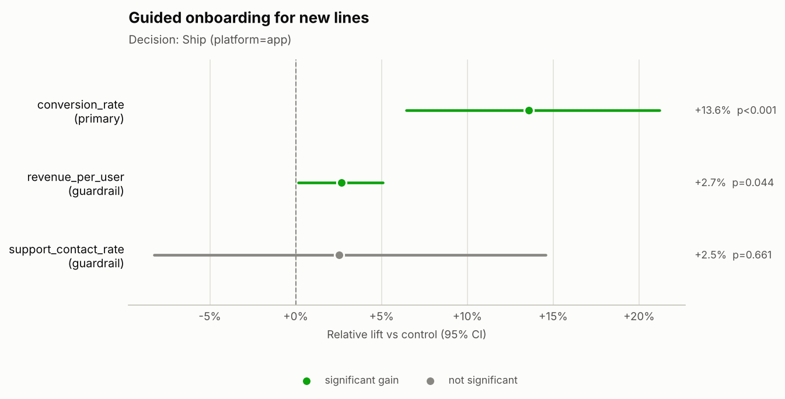
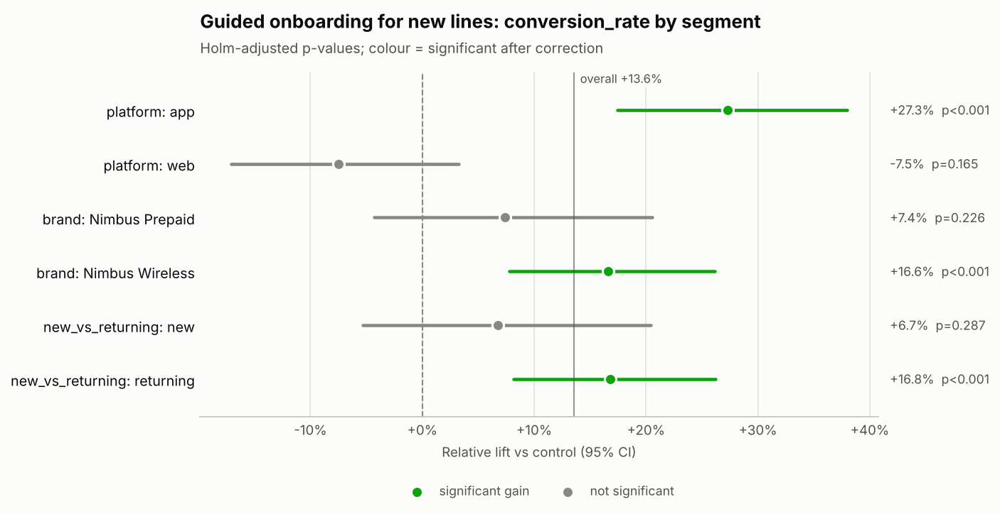

# Decision memo: Guided onboarding for new lines (`exp_app_onboarding`)

**Hypothesis:** A guided activation flow for new lines increases activation conversion across app and web.

## Decision
**Ship** — scope: **platform=app**

Why: Primary metric improved, driven by platform=app; ship to that segment only.

## Key numbers
- **Sample ratio:** 20,000 control vs 20,000 treatment (treatment share 50.0% vs designed 50.0%); SRM chi-square p = 1.000 -> no SRM.
- **Primary — conversion_rate:** 7.85% control vs 8.91% treatment; +13.6% relative (95% CI +6.4% to +21.2%), p < 0.001.
- **Power:** 20,000 users per arm vs 19,270 required for a 10% MDE; achieved power 81%; smallest detectable lift now +9.8%.
- **Duration:** 14 of 14 planned days (2026-05-04 to 2026-05-17).

## Guardrails
| Guardrail | Control | Treatment | Effect | Status |
|---|---|---|---|---|
| revenue_per_user | $21.19 | $21.65 | +2.7% relative (95% CI +0.1% to +5.1%), p = 0.044 | Improved |
| support_contact_rate | 2.99% | 3.06% | +2.5% relative (95% CI -8.3% to +14.6%), p = 0.661 | No significant change |

The revenue_per_user effect is CUPED-adjusted with its pre-period covariate, which cut variance by 30.6%; the control and treatment columns show raw arm means.

## Segment insights
- **platform** — effects **differ** across levels (Cochran's Q p < 0.001):
  - app: +27.3% (CI +17.4% to +38.0%), Holm-adjusted p < 0.001 ✓
  - web: -7.5% (CI -17.1% to +3.3%), Holm-adjusted p = 0.165
- **brand** — no evidence effects differ (Cochran's Q p = 0.166):
  - Nimbus Prepaid: +7.4% (CI -4.3% to +20.5%), Holm-adjusted p = 0.226
  - Nimbus Wireless: +16.6% (CI +7.8% to +26.1%), Holm-adjusted p < 0.001 ✓
- **new_vs_returning** — no evidence effects differ (Cochran's Q p = 0.089):
  - new: +6.7% (CI -5.3% to +20.4%), Holm-adjusted p = 0.287
  - returning: +16.8% (CI +8.1% to +26.2%), Holm-adjusted p < 0.001 ✓

The overall lift is concentrated in **platform=app**; other levels should not receive the change.

✓ = significant after multiple-comparison correction.

## Risks
- Novelty effects can fade; monitor the primary metric after rollout.

## Next steps
1. Roll out to platform=app only behind a feature flag and monitor guardrails for two weeks.
2. Add this result to the experiment log with the measured lift.

## Charts

---
_Generated by ab-test-agent in offline (rule-based MockLLM) mode (model: `mock`). Validator: PASSED — 61 numbers traced to tool outputs; decision consistent with rules. Tools called: get_experiment_metadata, check_srm, estimate_effect, power_analysis, check_duration, segment_breakdown._
