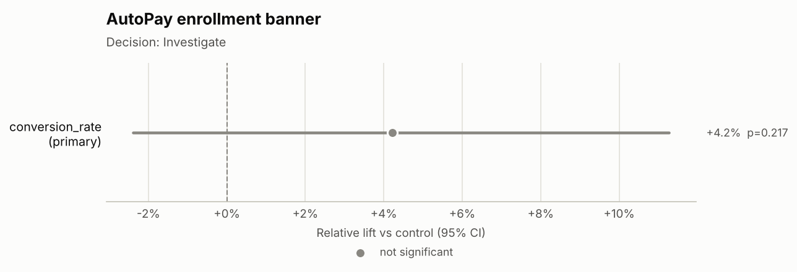

# Decision memo: AutoPay enrollment banner (`exp_autopay_banner`)

**Hypothesis:** A persistent AutoPay banner on the bill-pay screen increases AutoPay enrollment without increasing care contacts.

## Decision
**Investigate**

Why: Sample-ratio mismatch: allocation differs from design, so every metric is suspect.

## Key numbers
- **Sample ratio:** 20,000 control vs 18,500 treatment (treatment share 48.1% vs designed 50.0%); SRM chi-square p < 0.001 -> **SRM detected**.
- **Primary — conversion_rate:** 8.33% control vs 8.69% treatment; +4.2% relative (95% CI -2.4% to +11.3%), p = 0.217 *(not trustworthy: SRM)*.
- **Duration:** 14 of 14 planned days (2026-04-06 to 2026-04-19).

## Guardrails
- Not evaluated (results invalid until the SRM is resolved).

## Segment insights
- Not analysed (segment cuts on an invalid experiment would mislead).

## Risks
- Sample-ratio mismatch means users were lost or mis-assigned non-randomly; any lift may be an artefact of who is missing.

## Next steps
1. Audit assignment and exposure logging by platform, brand and day to find where treatment users are dropped.
2. Fix the bug, then restart the test with fresh assignment; do not reuse this data.

## Charts

---
_Generated by ab-test-agent in offline (rule-based MockLLM) mode (model: `mock`). Validator: PASSED — 14 numbers traced to tool outputs; decision consistent with rules. Tools called: get_experiment_metadata, check_srm, estimate_effect, check_duration._
