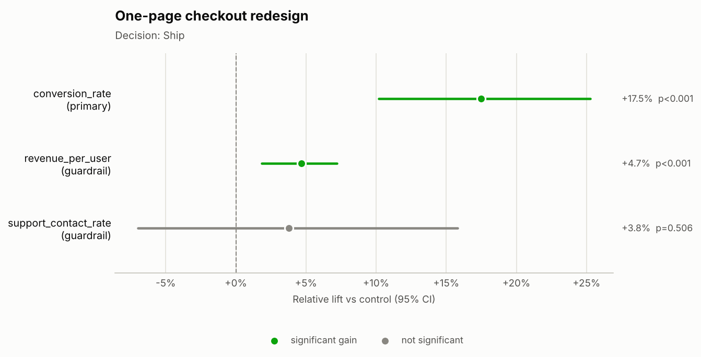
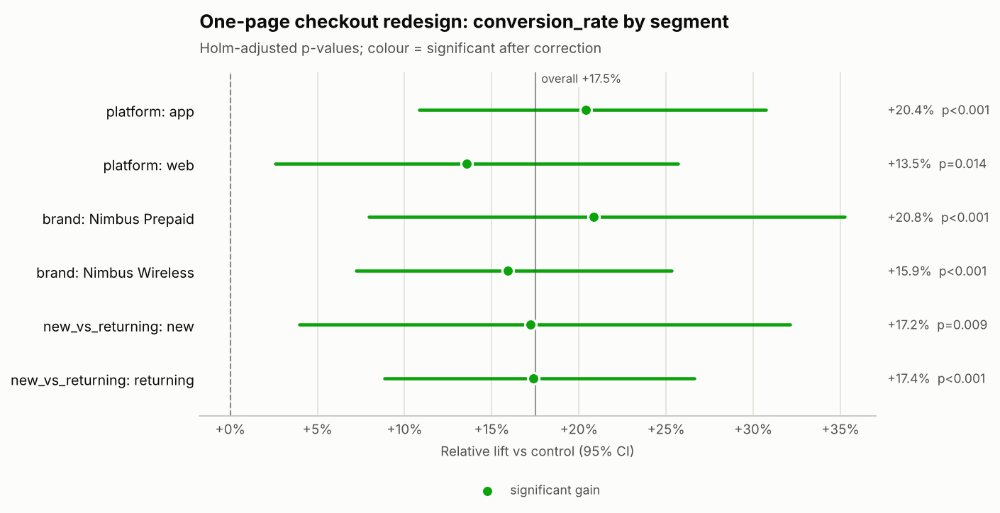

# Decision memo: One-page checkout redesign (`exp_checkout_redesign`)

**Hypothesis:** Collapsing the three-step device checkout into a single page reduces friction and increases checkout conversion.

## Decision
**Ship**

Why: Primary metric significantly improved with no guardrail regressions.

## Key numbers
- **Sample ratio:** 20,000 control vs 20,000 treatment (treatment share 50.0% vs designed 50.0%); SRM chi-square p = 1.000 -> no SRM.
- **Primary — conversion_rate:** 7.92% control vs 9.30% treatment; +17.5% relative (95% CI +10.2% to +25.3%), p < 0.001.
- **Power:** 20,000 users per arm vs 19,084 required for a 10% MDE; achieved power 82%; smallest detectable lift now +9.8%.
- **Duration:** 14 of 14 planned days (2026-03-02 to 2026-03-15).

## Guardrails
| Guardrail | Control | Treatment | Effect | Status |
|---|---|---|---|---|
| revenue_per_user | $21.05 | $22.27 | +4.7% relative (95% CI +1.9% to +7.2%), p < 0.001 | Improved |
| support_contact_rate | 3.03% | 3.15% | +3.8% relative (95% CI -7.0% to +15.8%), p = 0.506 | No significant change |

The revenue_per_user effect is CUPED-adjusted with its pre-period covariate, which cut variance by 32.1%; the control and treatment columns show raw arm means.

## Segment insights
- **platform** — no evidence effects differ (Cochran's Q p = 0.178):
  - app: +20.4% (CI +10.8% to +30.7%), Holm-adjusted p < 0.001 ✓
  - web: +13.5% (CI +2.6% to +25.7%), Holm-adjusted p = 0.014 ✓
- **brand** — no evidence effects differ (Cochran's Q p = 0.717):
  - Nimbus Prepaid: +20.8% (CI +8.0% to +35.3%), Holm-adjusted p < 0.001 ✓
  - Nimbus Wireless: +15.9% (CI +7.2% to +25.3%), Holm-adjusted p < 0.001 ✓
- **new_vs_returning** — no evidence effects differ (Cochran's Q p = 0.506):
  - new: +17.2% (CI +4.0% to +32.1%), Holm-adjusted p = 0.009 ✓
  - returning: +17.4% (CI +8.8% to +26.6%), Holm-adjusted p < 0.001 ✓

✓ = significant after multiple-comparison correction.

## Risks
- Novelty effects can fade; monitor the primary metric after rollout.

## Next steps
1. Roll out to all users behind a feature flag and monitor guardrails for two weeks.
2. Add this result to the experiment log with the measured lift.

## Charts

---
_Generated by ab-test-agent in offline (rule-based MockLLM) mode (model: `mock`). Validator: PASSED — 61 numbers traced to tool outputs; decision consistent with rules. Tools called: get_experiment_metadata, check_srm, estimate_effect, power_analysis, check_duration, segment_breakdown._
