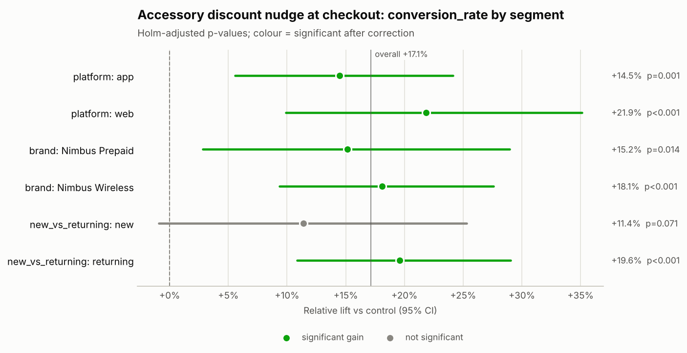

# Decision memo: Accessory discount nudge at checkout (`exp_discount_nudge`)

**Hypothesis:** Offering a 30% accessory discount at checkout increases accessory attach (conversion) and grows revenue per user.

## Decision
**Don't ship**

Why: Primary metric improved but guardrail(s) revenue_per_user significantly regressed.

## Key numbers
- **Sample ratio:** 20,000 control vs 20,000 treatment (treatment share 50.0% vs designed 50.0%); SRM chi-square p = 1.000 -> no SRM.
- **Primary — conversion_rate:** 7.99% control vs 9.37% treatment; +17.1% relative (95% CI +9.9% to +24.9%), p < 0.001.
- **Power:** 20,000 users per arm vs 18,876 required for a 10% MDE; achieved power 82%; smallest detectable lift now +9.7%.
- **Duration:** 14 of 14 planned days (2026-04-20 to 2026-05-03).

## Guardrails
| Guardrail | Control | Treatment | Effect | Status |
|---|---|---|---|---|
| revenue_per_user | $21.09 | $20.09 | -5.3% relative (95% CI -7.7% to -3.1%), p < 0.001 | **Regressed** |
| support_contact_rate | 3.11% | 3.02% | -2.9% relative (95% CI -13.0% to +8.4%), p = 0.602 | No significant change |

The revenue_per_user effect is CUPED-adjusted with its pre-period covariate, which cut variance by 36.9%; the control and treatment columns show raw arm means.

## Segment insights
- **platform** — no evidence effects differ (Cochran's Q p = 0.762):
  - app: +14.5% (CI +5.6% to +24.1%), Holm-adjusted p = 0.001 ✓
  - web: +21.9% (CI +9.9% to +35.1%), Holm-adjusted p < 0.001 ✓
- **brand** — no evidence effects differ (Cochran's Q p = 0.522):
  - Nimbus Prepaid: +15.2% (CI +2.8% to +29.0%), Holm-adjusted p = 0.014 ✓
  - Nimbus Wireless: +18.1% (CI +9.3% to +27.6%), Holm-adjusted p < 0.001 ✓
- **new_vs_returning** — no evidence effects differ (Cochran's Q p = 0.120):
  - new: +11.4% (CI -0.9% to +25.3%), Holm-adjusted p = 0.071
  - returning: +19.6% (CI +10.9% to +29.0%), Holm-adjusted p < 0.001 ✓

✓ = significant after multiple-comparison correction.

## Risks
- Shipping would regress revenue_per_user.

## Next steps
1. Do not roll out. Explore a variant that keeps the primary gain without the guardrail cost (e.g. a smaller incentive).
2. Re-test the revised variant with the same guardrails.

## Charts

---
_Generated by ab-test-agent in offline (rule-based MockLLM) mode (model: `mock`). Validator: PASSED — 62 numbers traced to tool outputs; decision consistent with rules. Tools called: get_experiment_metadata, check_srm, estimate_effect, power_analysis, check_duration, segment_breakdown._
