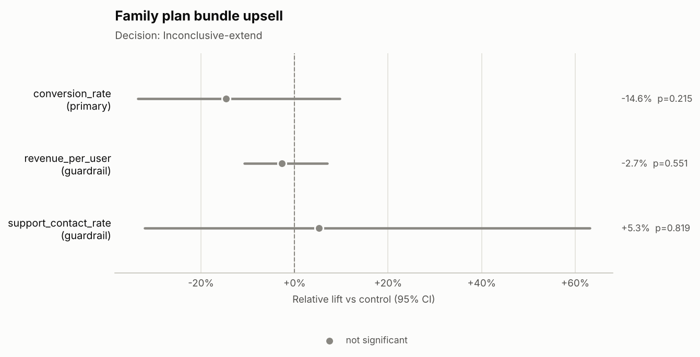
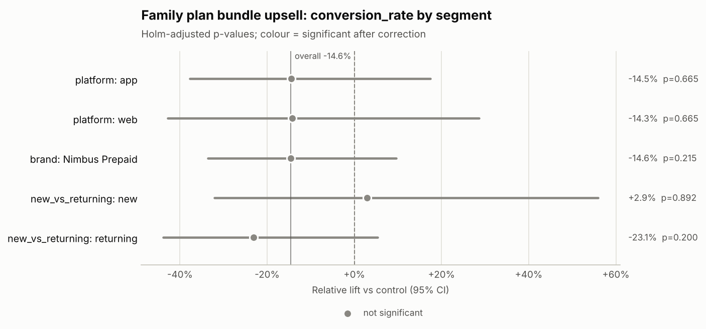

# Decision memo: Family plan bundle upsell (`exp_family_bundle`)

**Hypothesis:** Showing a family-plan bundle offer to prepaid customers increases bundle conversion.

## Decision
**Inconclusive-extend**

Why: No significant effect yet, but the test is underpowered for the MDE.

## Key numbers
- **Sample ratio:** 1,500 control vs 1,500 treatment (treatment share 50.0% vs designed 50.0%); SRM chi-square p = 1.000 -> no SRM.
- **Primary — conversion_rate:** 8.20% control vs 7.00% treatment; -14.6% relative (95% CI -33.5% to +9.7%), p = 0.215.
- **Power:** 1,500 users per arm vs 18,361 required for a 10% MDE; achieved power 13%; smallest detectable lift now +36.8%.
- **Duration:** 6 of 14 planned days (2026-05-18 to 2026-05-23).

## Guardrails
| Guardrail | Control | Treatment | Effect | Status |
|---|---|---|---|---|
| revenue_per_user | $20.98 | $20.55 | -2.7% relative (95% CI -10.8% to +7.0%), p = 0.551 | No significant change |
| support_contact_rate | 2.53% | 2.67% | +5.3% relative (95% CI -32.1% to +63.1%), p = 0.819 | No significant change |

The revenue_per_user effect is CUPED-adjusted with its pre-period covariate, which cut variance by 33.9%; the control and treatment columns show raw arm means.

## Segment insights
- **platform** — no evidence effects differ (Cochran's Q p = 0.837):
  - app: -14.5% (CI -37.8% to +17.5%), Holm-adjusted p = 0.665
  - web: -14.3% (CI -42.8% to +28.6%), Holm-adjusted p = 0.665
- **brand** — no evidence effects differ (Cochran's Q p = 1.000):
  - Nimbus Prepaid: -14.6% (CI -33.5% to +9.7%), Holm-adjusted p = 0.215
- **new_vs_returning** — no evidence effects differ (Cochran's Q p = 0.286):
  - new: +2.9% (CI -32.1% to +55.9%), Holm-adjusted p = 0.892
  - returning: -23.1% (CI -43.9% to +5.3%), Holm-adjusted p = 0.200

✓ = significant after multiple-comparison correction.

## Risks
- Read after 6 of 14 planned days; the decision should wait for the planned duration.
- Less than one full weekly cycle observed; day-of-week effects are not averaged out.
- Only 8% of the required sample collected; a nominal p-value read now overstates confidence (use the sequential alpha).
- Underpowered: a real effect the size of the MDE could easily be missed.

## Next steps
1. Keep the test running until 18,361 users per arm (about 16,861 more per arm, ~68 more days at the current pace).
2. Do not act on interim reads; re-run this analysis at the planned end date.

## Charts

---
_Generated by ab-test-agent in offline (rule-based MockLLM) mode (model: `mock`). Validator: PASSED — 63 numbers traced to tool outputs; decision consistent with rules. Tools called: get_experiment_metadata, check_srm, estimate_effect, power_analysis, check_duration, segment_breakdown._
