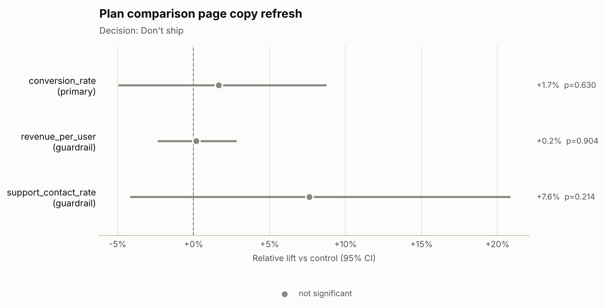
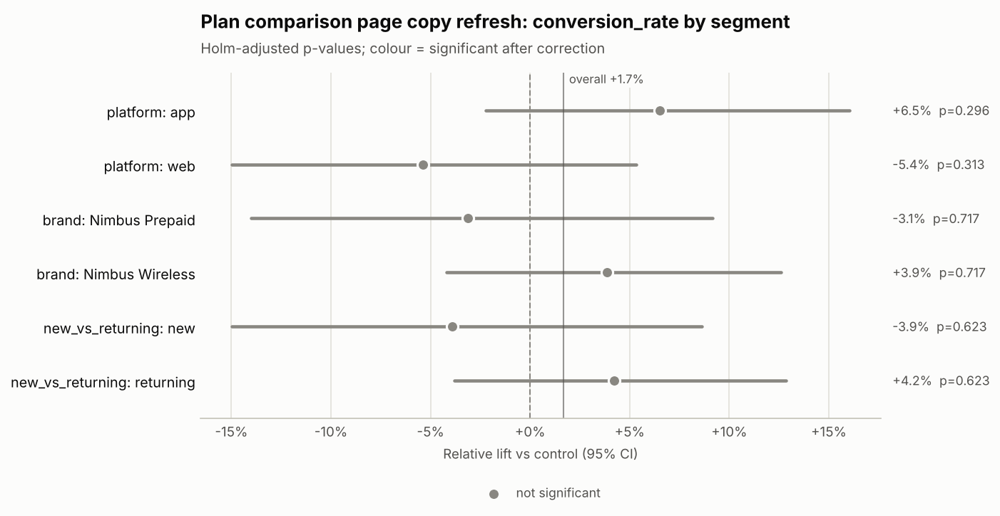

# Decision memo: Plan comparison page copy refresh (`exp_plan_page_copy`)

**Hypothesis:** Rewriting plan comparison copy in plain language helps customers pick a plan and increases plan-change conversion.

## Decision
**Don't ship**

Why: No significant effect and the test was powered for the MDE.

## Key numbers
- **Sample ratio:** 20,000 control vs 20,000 treatment (treatment share 50.0% vs designed 50.0%); SRM chi-square p = 1.000 -> no SRM.
- **Primary — conversion_rate:** 7.83% control vs 7.96% treatment; +1.7% relative (95% CI -4.9% to +8.7%), p = 0.630.
- **Power:** 20,000 users per arm vs 19,297 required for a 10% MDE; achieved power 81%; smallest detectable lift now +9.8%.
- **Duration:** 14 of 14 planned days (2026-03-09 to 2026-03-22).

## Guardrails
| Guardrail | Control | Treatment | Effect | Status |
|---|---|---|---|---|
| revenue_per_user | $20.87 | $20.95 | +0.2% relative (95% CI -2.3% to +2.8%), p = 0.904 | No significant change |
| support_contact_rate | 2.70% | 2.90% | +7.6% relative (95% CI -4.1% to +20.8%), p = 0.214 | No significant change |

The revenue_per_user effect is CUPED-adjusted with its pre-period covariate, which cut variance by 32.2%; the control and treatment columns show raw arm means.

## Segment insights
- **platform** — no evidence effects differ (Cochran's Q p = 0.082):
  - app: +6.5% (CI -2.2% to +16.0%), Holm-adjusted p = 0.296
  - web: -5.4% (CI -15.0% to +5.3%), Holm-adjusted p = 0.313
- **brand** — no evidence effects differ (Cochran's Q p = 0.330):
  - Nimbus Prepaid: -3.1% (CI -14.0% to +9.2%), Holm-adjusted p = 0.717
  - Nimbus Wireless: +3.9% (CI -4.2% to +12.6%), Holm-adjusted p = 0.717
- **new_vs_returning** — no evidence effects differ (Cochran's Q p = 0.257):
  - new: -3.9% (CI -15.0% to +8.6%), Holm-adjusted p = 0.623
  - returning: +4.2% (CI -3.8% to +12.9%), Holm-adjusted p = 0.623

✓ = significant after multiple-comparison correction.

## Risks
- No material risks identified.

## Next steps
1. Close the test and keep control; the change did not move the primary metric.
2. Record the null result so the idea is not re-tested without a new hypothesis.

## Charts

---
_Generated by ab-test-agent in offline (rule-based MockLLM) mode (model: `mock`). Validator: PASSED — 61 numbers traced to tool outputs; decision consistent with rules. Tools called: get_experiment_metadata, check_srm, estimate_effect, power_analysis, check_duration, segment_breakdown._
